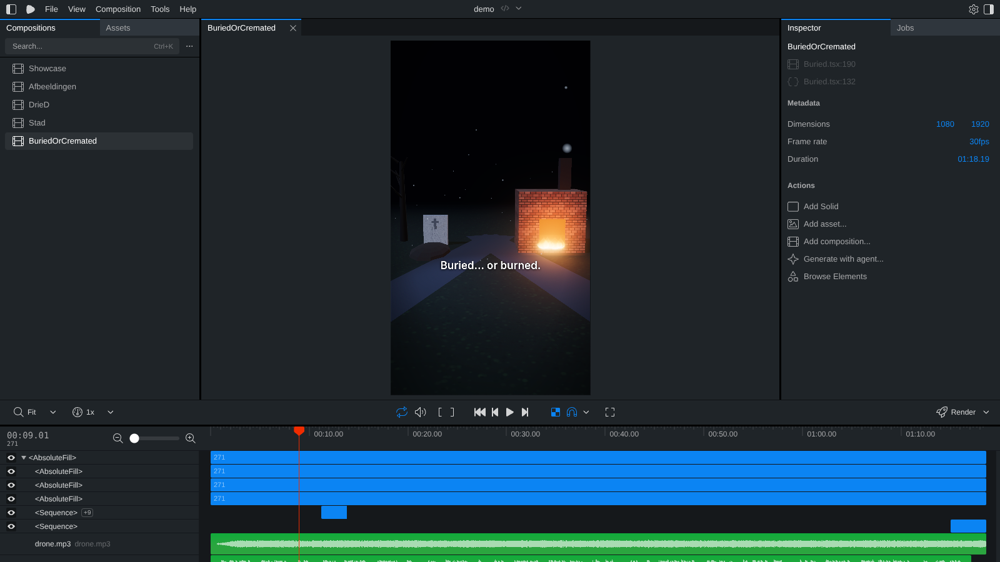

# Remotion + three.js op je eigen pc (stap voor stap)

Met Remotion maak je video's met code, ook in 3D (three.js). Je bekijkt en exporteert ze in je browser via **Remotion Studio**.
Alles is gratis (Remotion is gratis voor teams tot 3 personen). Voorbeeld in deze handleiding: de video
**"What happens to you if you're buried or cremated?"** (`alteraqon/2026-10-13-buried-or-cremated/`).

---

## Deel 1 – Eenmalig installeren

1. **Node.js** downloaden en installeren: <https://nodejs.org>, kies de **LTS**-versie, overal "Next".
2. Open **PowerShell** (startmenu → typ `powershell`). Controleer:
   ```
   node -v
   ```
   Zie je iets als `v22.x.x`? Dan is het goed.
3. Ga naar je map `vox-lux` en haal de laatste versie op:
   ```
   cd C:\pad\naar\vox-lux
   git fetch origin claude/cavalry-op-github-5t9zml
   git checkout claude/cavalry-op-github-5t9zml
   git pull
   ```
4. Installeer Remotion (alleen de eerste keer, duurt een paar minuten):
   ```
   cd tools\remotion\demo
   npm install
   ```

## Deel 2 – Remotion Studio openen

Elke keer dat je wilt werken (vanuit `vox-lux\tools\remotion\demo`):
```
npm run dev
```
Je browser opent vanzelf **http://localhost:3000** (zo niet: typ het adres zelf in). Stoppen: in PowerShell `Ctrl + C`.



Wat je ziet:
| Waar | Wat |
|---|---|
| **Links** | Alle video's: `Showcase`, `Afbeeldingen`, `DrieD`, `Stad`, `BuriedOrCremated`. Klik er één aan. |
| **Midden** | Het beeld. Je 3D-kaart (RTX 2080 Super) tekent het live. |
| **Onder** | De tijdlijn: sleep het rode streepje om door de video te gaan. Groene balken = geluid. |
| **Knoppen** | Spatie = afspelen/pauze, pijltjes = frame vooruit/terug. |
| **Rechtsonder: Render** | Exporteert de mp4. Klik **Render** → kies **Render video** → het bestand komt in `tools\remotion\demo\out\`. |

Pas je iets aan in de code (of doe je `git pull` na een wijziging van Claude)? Dan ververst de Studio vanzelf.

**Exporteren zonder Studio** (kan ook):
```
npx remotion render BuriedOrCremated out\buried-or-cremated.mp4
```

---

## Deel 3 – Zo is de buried-video gemaakt

Een 3D what-if video bestaat uit 4 stukken:

```
1. script-cues.txt     → de tekst (Engels), met {img:S01} voor elke scène
2. voice.mp3 + voice-times.tsv  → de stem (op jouw pc, gratis) + wanneer elke zin begint
3. buried-timeline.ts  → automatisch gemaakt uit stap 2: wanneer welke scène in beeld is
4. de 3D-scènes        → code: wat je ziet bij S01, S02, …
```

### Stap 1 – Het script schrijven
Bestand: `alteraqon/2026-10-13-buried-or-cremated/script-cues.txt`. Zo ziet het eruit:
```
{img:S01}
Imagine… your heart beats for the very last time. [pause]
{img:S02}
What happens next depends on one choice. Buried… or burned. [long pause]
{img:S05}
Option one. They lower you six feet into the cold earth. [pause]
{img:S06}
Then. [long pause]
```
Regels:
- `{img:S01}` op een eigen regel = **nieuwe scène** (één scène per zin of korte zinnen).
- Elke regel eindigt op `[pause]` (kort) of `[long pause]` (lang, voor spanning).
- `…` = de stem houdt even in. Getallen **voluit** schrijven ("nineteen ninety-seven", niet "1997").
- Opbouw van Alteraqon (zie `alteraqon/README.md`):
  1. **Opening**: "Imagine… …" (meteen zeggen waar het over gaat)
  2. **Opbouw**: kleine stappen, spanning
  3. **Het moment**: één kort woord: "Then."
  4. **Feiten met grote getallen** (elk een eigen scène + tijdstempel)
  5. **Twist**: "But…" + iets verrassends dat echt waar is
  6. **Slot**: "So remember." + vraag aan de kijker
- Ca. 18 zinnen, 65–80 seconden.

### Stap 2 – De stem (op jouw pc)
Vanuit `vox-lux`, met de stem-omgeving actief:
```
python tools/comfy/make_voice_local.py alteraqon/2026-10-13-buried-or-cremated --pause-ms 350 --long-pause-ms 800 --sentence-pause-ms 250
```
Dat maakt `voice.mp3` en `voice-times.tsv` (daarin staat per zin de start- en eindtijd).

### Stap 3 – Tijdlijn maken
```
python alteraqon/2026-10-13-buried-or-cremated/make_timeline.py
```
Dit schrijft `tools/remotion/demo/src/whatif/buried-timeline.ts` en kopieert de stem naar `public/buried/`.
Zonder stem schat het de tijden (handig om alvast te kijken).

### Stap 4 – De 3D-scènes
Map: `tools/remotion/demo/src/whatif/`
| Bestand | Wat staat erin |
|---|---|
| `Buried.tsx` | De video zelf: ondertitels, **tijdstempels** (lijst `STAMPS`), geluid, eindtitel |
| `buried-scenes.tsx` | De 18 scènes `S01`…`S18` (camera, licht, voorwerpen) |
| `props.tsx` | Bouwstenen: kist, skelet, lichaam onder laken, urn, vlammen, grafsteen, klok, raket, … |
| `quality.tsx` | Mooi beeld: filmische kleuren, reflecties, gloed (bloom), texturen |

**Makkelijke aanpassingen die je zelf kunt doen** (opslaan → Studio ververst):
- **Tijdstempel veranderen** – in `Buried.tsx`, lijst `STAMPS`:
  ```
  S13: ["WHAT'S LEFT", "5 LBS"],
  ```
  Links het kleine label, rechts het grote getal.
- **Eindtitel** – in `Buried.tsx`, onderdeel `EndTitle` (`BURIED` / `or` / `CREMATED?`).
- **Kleur van licht** – in `buried-scenes.tsx`, bijv. `color="#ff7a1a"` (oranje) → `color="#4aa3ff"` (blauw).
- **Camera** – elke scène heeft een regel `<Cam from={[x, y, z]} to={[x, y, z]} look={[…]} />`:
  de camera beweegt van `from` naar `to` en kijkt naar `look`. y = hoogte, z = afstand.
- **Geluid harder/zachter** – in `Buried.tsx`: `volume={0.32}` bij drone, `0.55` bij de klap.

---

## Deel 4 – Een nieuwe 3D what-if video

Makkelijkste manier: **vraag het aan Claude** in een sessie, bijvoorbeeld
*"Maak een 3D what-if video over … in de stijl van buried-or-cremated"*. Claude schrijft het script, de scènes en pusht.
Daarna doe jij alleen:
1. `git pull`
2. de stem maken (stap 2 hierboven, met de nieuwe map)
3. `git push` → Claude legt de beelden op de stem; of jij doet zelf stap 3 en klikt **Render** in de Studio.

Zelf proberen? Kopieer de map `alteraqon/2026-10-13-buried-or-cremated/` naar een nieuwe naam, schrijf je eigen
`script-cues.txt`, en hergebruik scènes uit `buried-scenes.tsx` (dezelfde `S01`-namen in het script = dezelfde beelden).

## Problemen?
- **`npm` of `node` niet gevonden** → Node.js opnieuw installeren en PowerShell opnieuw openen.
- **Studio blijft zwart** → wacht even (de eerste keer bouwt hij alles), of ververs de pagina (F5).
- **Render traag** → zet in de Studio bij Render de *Concurrency* hoger (bijv. 4).
- **Iets kapot na een aanpassing** → in PowerShell `git checkout -- .` zet alles terug naar de laatste versie (je eigen wijzigingen zijn dan weg).
